# Практическое занятие №1. Введение, основы работы в командной строке

**Выполнил:** Соколов Даниил Антонович, группа ИКБО-42-25
**РТУ МИРЭА, Институт информационных технологий, кафедра вычислительной техники**

**Цель работы:** научиться выполнять простые действия с файлами и каталогами
в Linux из командной строки и сравнить командную строку Windows и Linux.

Команды ниже запускаются из каталога `practice1`.

---

## Задача 1

**Условие.** Вывести отсортированный в алфавитном порядке список имён пользователей
в файле passwd (понадобится grep).

**Решение.** В `/etc/passwd` имя пользователя стоит до первого двоеточия.
Сначала `grep -v` отбрасывает строки-комментарии, затем `grep -o '^[^:]*'`
оставляет только это поле. `LC_ALL=C sort` сортирует имена как обычные байтовые
строки, без зависимости от локали.

Файл [`src/task1.sh`](src/task1.sh):

```bash
#!/bin/bash
set -euo pipefail

passwd_file="${1:-/etc/passwd}"

if [[ ! -f "$passwd_file" ]]; then
    printf 'Нет файла: %s\n' "$passwd_file" >&2
    exit 1
fi

grep -v '^[[:space:]]*#' "$passwd_file" | grep -o '^[^:]*' | LC_ALL=C sort
```

**Запуск:** `./src/task1.sh`

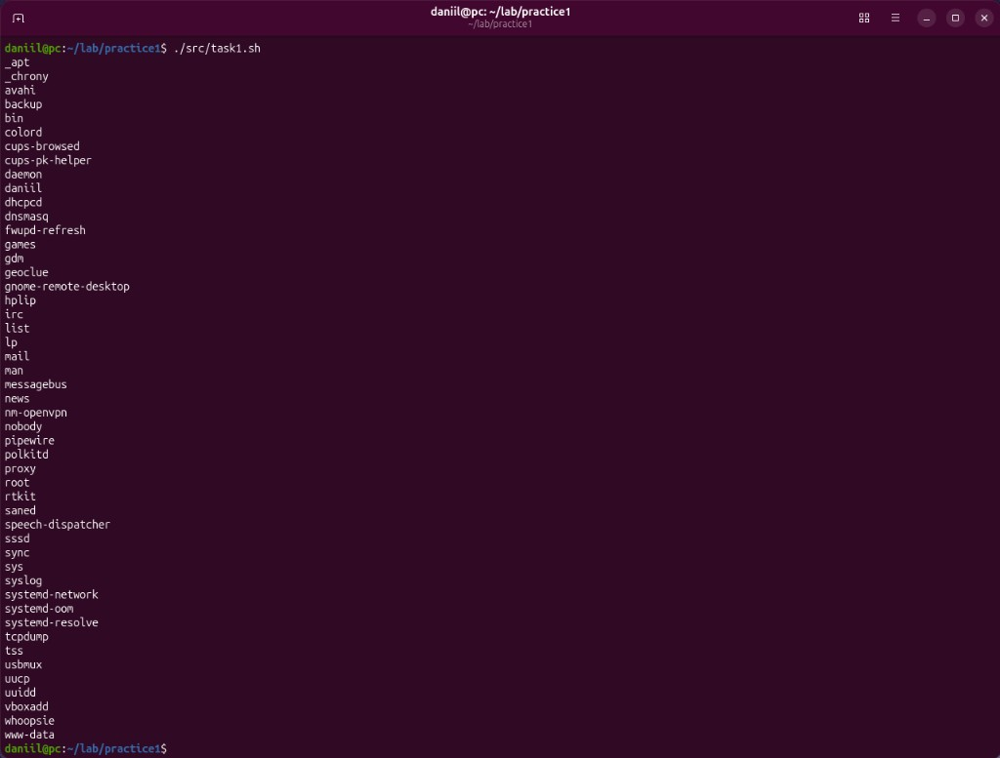

---

## Задача 2

**Условие.** Вывести данные `/etc/protocols` в отформатированном и отсортированном
порядке для 5 наибольших номеров.

**Решение.** Комментарии и пустые строки убирает `grep -Ev`. В файле сначала идёт
имя протокола, потом номер, поэтому `awk` печатает номер и имя в обратном порядке.
`sort -k1,1nr` сортирует по номеру по убыванию. Список сначала записывается во
временный файл, и уже из него `head` берёт пять строк: так `sort` не обрывается
сигналом SIGPIPE при включённом `pipefail`.

Файл [`src/task2.sh`](src/task2.sh):

```bash
#!/bin/bash
set -euo pipefail

limit="${1:-5}"
proto_file="${2:-/etc/protocols}"

if [[ ! -f "$proto_file" ]]; then
    printf 'Нет файла: %s\n' "$proto_file" >&2
    exit 1
fi

ranked=$(mktemp)
trap 'rm -f "$ranked"' EXIT

grep -Ev '^[[:space:]]*(#|$)' "$proto_file" \
    | awk 'NF >= 2 { printf "%s %s\n", $2, $1 }' \
    | sort -k1,1nr > "$ranked"

head -n "$limit" "$ranked"
```

**Запуск:** `./src/task2.sh`

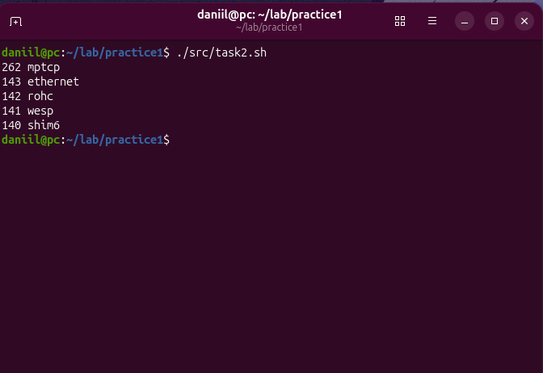

---

## Задача 3

**Условие.** Написать программу `banner` на bash: текст в рамке, размер рамки
зависит от длины текста.

**Решение.** Все аргументы склеиваются в одну строку через `"$*"`. Ширина внутренней
части равна длине текста плюс два пробела. Строка из дефисов строится так:
`printf '%*s'` печатает нужное число пробелов, `tr` заменяет их на `-`.

Файл [`src/banner`](src/banner):

```bash
#!/bin/bash
set -euo pipefail

if [[ $# -eq 0 ]]; then
    printf 'Использование: %s ТЕКСТ\n' "$0" >&2
    exit 1
fi

text="$*"
width=$((${#text} + 2))
rule=$(printf '%*s' "$width" '' | tr ' ' '-')

printf '+%s+\n' "$rule"
printf '| %s |\n' "$text"
printf '+%s+\n' "$rule"
```

**Запуск:** `./src/banner "Hello from RTU MIREA!"` и `./src/banner "OK"`

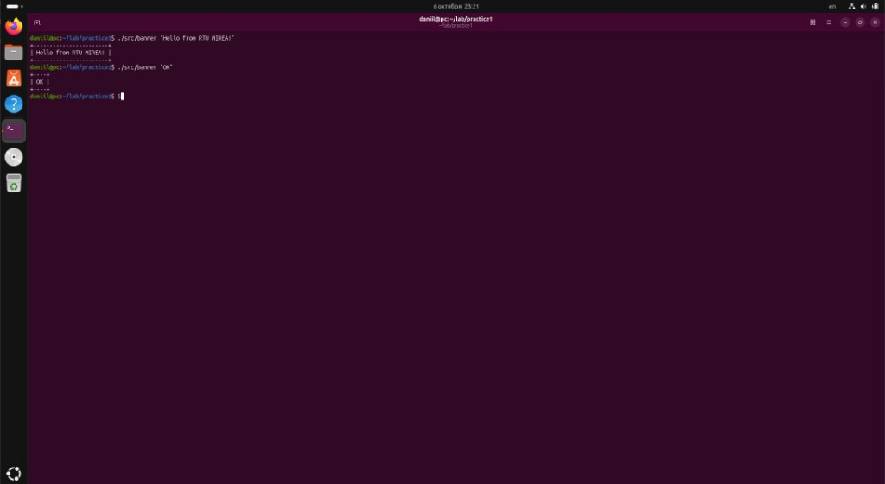

**Проверка в ShellCheck.** Предупреждений нет.

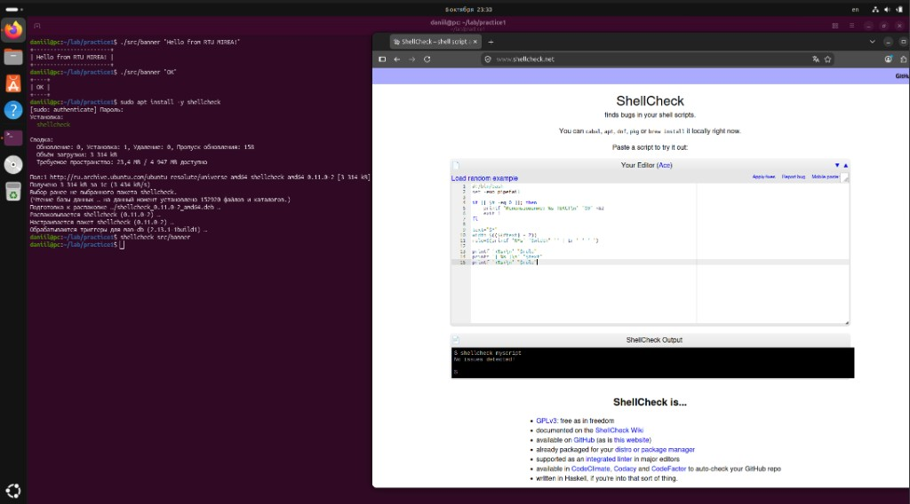

---

## Задача 4

**Условие.** Написать программу для вывода всех идентификаторов (по правилам C/C++
или Java) в файле, без повторений.

**Решение.** Идентификатор начинается с буквы или `_` и дальше содержит буквы,
цифры и `_`. `grep -oE` печатает каждое совпадение отдельно, `sort -u` убирает
повторы, `paste -sd ' '` собирает их в одну строку через пробел.

Файл [`src/task4.sh`](src/task4.sh):

```bash
#!/bin/bash
set -euo pipefail

if [[ $# -ne 1 ]]; then
    printf 'Использование: %s ФАЙЛ\n' "$0" >&2
    exit 1
fi

if [[ ! -f "$1" ]]; then
    printf 'Нет файла: %s\n' "$1" >&2
    exit 1
fi

names=$(grep -oE '[A-Za-z_][A-Za-z0-9_]*' "$1" | LC_ALL=C sort -u | paste -sd ' ' - || true)
printf '%s\n' "$names"
```

**Запуск:** `./src/task4.sh demo/hello.c`

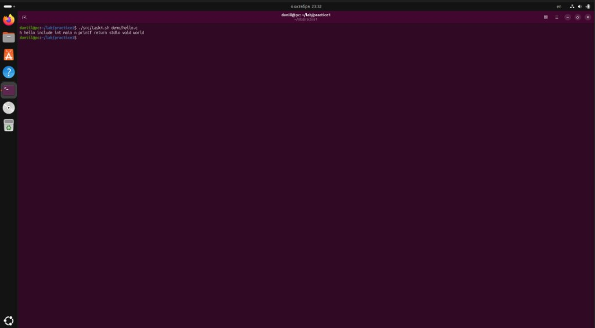

Ожидаемая строка совпадает с примером из задания:

```text
h hello include int main n printf return stdio void world
```

`h` берётся из `stdio.h`, `n` — из escape-последовательности `\n`. Оба фрагмента
подходят под правило идентификатора.

---

## Задача 5

**Условие.** Написать программу для регистрации пользовательской команды:
выставить права на выполнение и скопировать файл в `/usr/local/bin`.

**Решение.** Утилита `install -m 0755` сразу копирует файл и ставит права
`rwxr-xr-x`. Каталог `/usr/local/bin` обычно есть в `PATH`, поэтому команду можно
вызвать без `./`. Запись туда требует root, поэтому без прав суперпользователя
вызывается `sudo`.

Файл [`src/reg`](src/reg):

```bash
#!/bin/bash
set -euo pipefail

target_dir="/usr/local/bin"

if [[ $# -ne 1 ]]; then
    printf 'Использование: %s ФАЙЛ\n' "$0" >&2
    exit 1
fi

program="$1"

if [[ ! -f "$program" ]]; then
    printf 'Нет файла: %s\n' "$program" >&2
    exit 1
fi

if [[ ! -d "$target_dir" ]]; then
    printf 'Нет каталога: %s\n' "$target_dir" >&2
    exit 1
fi

command_name=$(basename -- "$program")

if [[ "$(id -u)" -eq 0 ]]; then
    install -m 0755 -- "$program" "${target_dir}/${command_name}"
else
    sudo install -m 0755 -- "$program" "${target_dir}/${command_name}"
fi

printf 'Команда %s записана в %s (права 0755)\n' "$command_name" "$target_dir"
```

**Запуск:** `./src/reg src/banner`, затем `banner "reg works"` уже без пути к файлу.

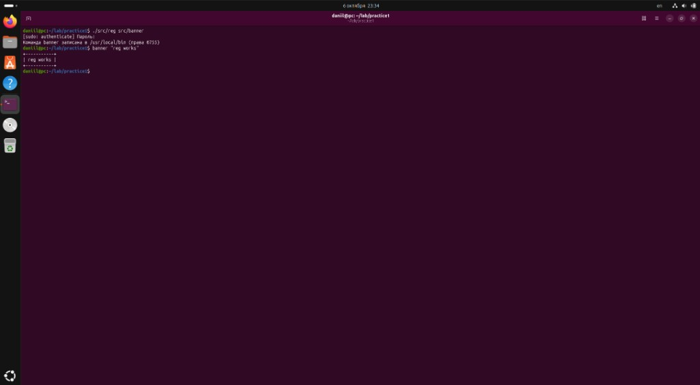

---

## Задача 6

**Условие.** Написать программу для проверки комментария в первой строке файлов
с расширением c, js и py.

**Решение.** `find` отбирает файлы трёх расширений и отдаёт имена через NUL,
чтобы пробел в имени не разбивал путь. У Python комментарий в первой строке — это
`#`, у C и JavaScript — `//` или `/*`. `head -n 1` читает только первую строку.

Файл [`src/task6.sh`](src/task6.sh):

```bash
#!/bin/bash
set -euo pipefail

root="${1:-.}"

if [[ ! -d "$root" ]]; then
    printf 'Нет каталога: %s\n' "$root" >&2
    exit 1
fi

while IFS= read -r -d '' path; do
    first=$(head -n 1 -- "$path" || true)
    name=$(basename -- "$path")

    case "$name" in
        *.py)
            pattern='^[[:space:]]*#'
            ;;
        *.c|*.js)
            pattern='^[[:space:]]*(//|/\*)'
            ;;
        *)
            continue
            ;;
    esac

    if printf '%s\n' "$first" | grep -Eq "$pattern"; then
        printf 'есть комментарий: %s\n' "$path"
    else
        printf 'нет комментария: %s\n' "$path"
    fi
done < <(find "$root" -type f \( -name '*.c' -o -name '*.js' -o -name '*.py' \) -print0 | sort -z)
```

**Запуск:** `./src/task6.sh demo`

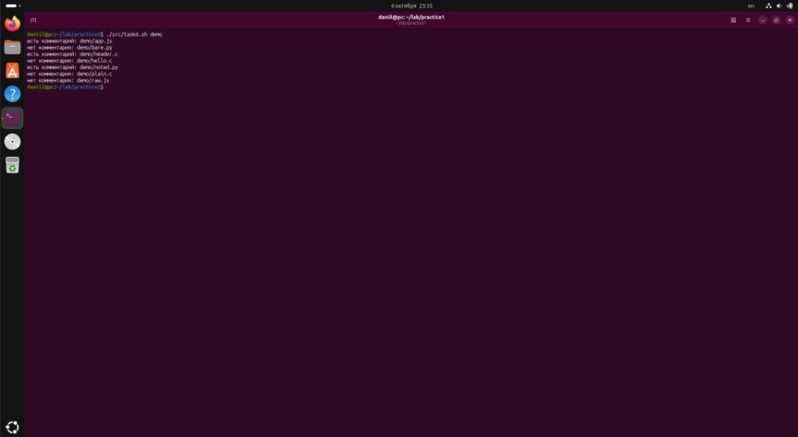

В каталоге `demo` комментарий есть у `app.js`, `header.c` и `noted.py`.
У `hello.c` первая строка — `#include`, это не комментарий.

---

## Задача 7

**Условие.** Написать программу для нахождения файлов-дубликатов (одна и более
копий содержимого) по заданному пути, включая подкаталоги.

**Решение.** Сравнивается содержимое, а не имя: `sha256sum` считает контрольную
сумму каждого файла. Одинаковые суммы после сортировки стоят рядом. `awk` собирает
такие группы и печатает только пути; группы разделяются пустой строкой. Уникальные
файлы в вывод не попадают.

Файл [`src/task7.sh`](src/task7.sh):

```bash
#!/bin/bash
set -euo pipefail

root="${1:-.}"

if [[ ! -d "$root" ]]; then
    printf 'Нет каталога: %s\n' "$root" >&2
    exit 1
fi

find "$root" -type f -exec sha256sum {} + | LC_ALL=C sort | awk '
{
    sum = $1
    sub(/^[^ ]+[[:space:]]+/, "")
    if (count > 0 && sum != prev) {
        if (count > 1) {
            for (i = 1; i <= count; i++) {
                print items[i]
            }
            print ""
        }
        count = 0
    }
    count++
    items[count] = $0
    prev = sum
}
END {
    if (count > 1) {
        for (i = 1; i <= count; i++) {
            print items[i]
        }
        print ""
    }
}
'
```

**Запуск:** `./src/task7.sh demo`

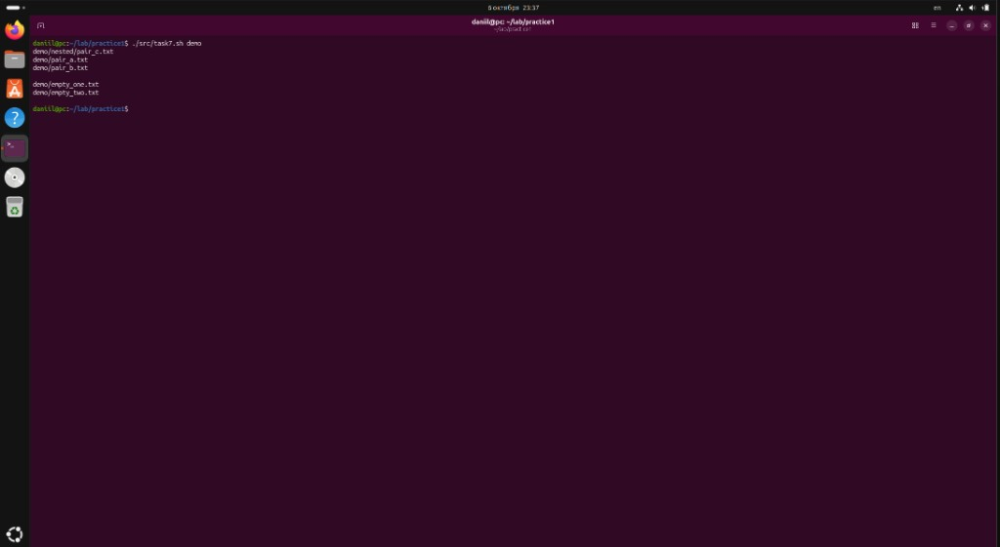

В `demo` две группы. Три файла с текстом `payload` (`pair_a.txt`, `pair_b.txt`
и `nested/pair_c.txt`) и два пустых файла. Файл `only.txt` встречается один раз
и в список не входит. Файл из `nested/` показывает, что обход идёт по подкаталогам.

---

## Задача 8

**Условие.** Найти в каталоге все файлы с заданным расширением и упаковать их
в архив tar.

**Решение.** Расширение можно передать и как `txt`, и как `.txt`: `${2#.}` снимает
одну ведущую точку. `find -print0` и `tar --null -T -` передают имена через NUL,
поэтому пробел в имени файла не ломает архив. Если подходящих файлов нет, скрипт
завершается с ошибкой и пустой архив не создаёт.

Файл [`src/task8.sh`](src/task8.sh):

```bash
#!/bin/bash
set -euo pipefail

if [[ $# -lt 2 ]]; then
    printf 'Использование: %s КАТАЛОГ РАСШИРЕНИЕ [АРХИВ]\n' "$0" >&2
    exit 1
fi

root="$1"
ext="${2#.}"
archive="${3:-${ext}_files.tar}"

if [[ ! -d "$root" ]]; then
    printf 'Нет каталога: %s\n' "$root" >&2
    exit 1
fi

first=$(find "$root" -type f -name "*.${ext}" -print -quit)
if [[ -z "$first" ]]; then
    printf 'Файлы *.%s не найдены в %s\n' "$ext" "$root" >&2
    exit 1
fi

find "$root" -type f -name "*.${ext}" -print0 \
    | tar --null -cf "$archive" -T -

printf 'Создан архив %s\n' "$archive"
tar -tf "$archive"
```

**Запуск:** `./src/task8.sh demo txt texts.tar`

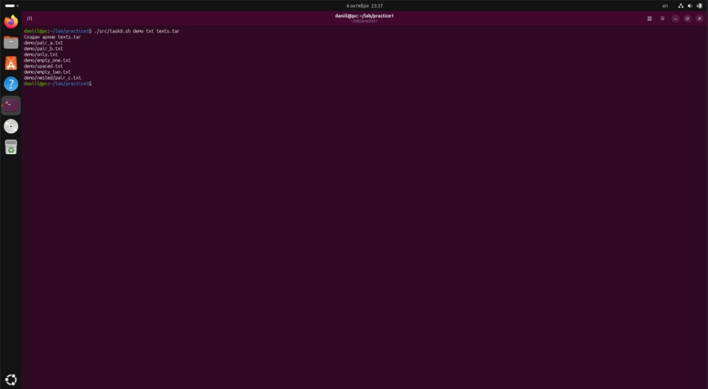

---

## Задача 9

**Условие.** Заменить в файле последовательности из 4 пробелов на символ табуляции.
Входной и выходной файлы задаются аргументами.

**Решение.** `awk` с `gsub` меняет каждое вхождение четырёх пробелов на `\t` во
всей строке, не только в отступе. Исходный файл не перезаписывается. Проверка —
`cat -A`: табуляция отображается как `^I`, конец строки как `$`.

Файл [`src/task9.sh`](src/task9.sh):

```bash
#!/bin/bash
set -euo pipefail

if [[ $# -ne 2 ]]; then
    printf 'Использование: %s ВХОД ВЫХОД\n' "$0" >&2
    exit 1
fi

src="$1"
dst="$2"

if [[ ! -f "$src" ]]; then
    printf 'Нет файла: %s\n' "$src" >&2
    exit 1
fi

if [[ "$src" -ef "$dst" ]]; then
    printf 'Вход и выход не должны быть одним файлом\n' >&2
    exit 1
fi

awk '{ gsub(/    /, "\t"); print }' "$src" > "$dst"
printf 'Записано: %s\n' "$dst"
```

**Запуск:** `./src/task9.sh demo/spaced.txt demo/spaced.out`, затем
`cat -A demo/spaced.txt demo/spaced.out`

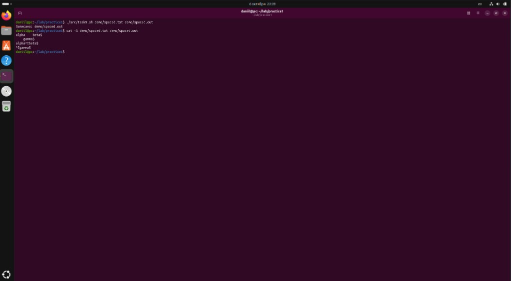

---

## Задача 10

**Условие.** Вывести названия всех пустых текстовых файлов в указанной директории.
Директория передаётся параметром.

**Решение.** `find -size 0c` выбирает файлы нулевой длины, `-maxdepth 1` не спускается
в подкаталоги, `-printf '%f\n'` печатает только имя без пути. По умолчанию расширение
`txt`.

Файл [`src/task10.sh`](src/task10.sh):

```bash
#!/bin/bash
set -euo pipefail

if [[ $# -lt 1 ]]; then
    printf 'Использование: %s КАТАЛОГ [РАСШИРЕНИЕ]\n' "$0" >&2
    exit 1
fi

root="$1"
ext="${2:-txt}"
ext="${ext#.}"

if [[ ! -d "$root" ]]; then
    printf 'Нет каталога: %s\n' "$root" >&2
    exit 1
fi

find "$root" -maxdepth 1 -type f -name "*.${ext}" -size 0c -printf '%f\n' | LC_ALL=C sort
```

**Запуск:** `./src/task10.sh demo` и для проверки `ls -l demo/*.txt`

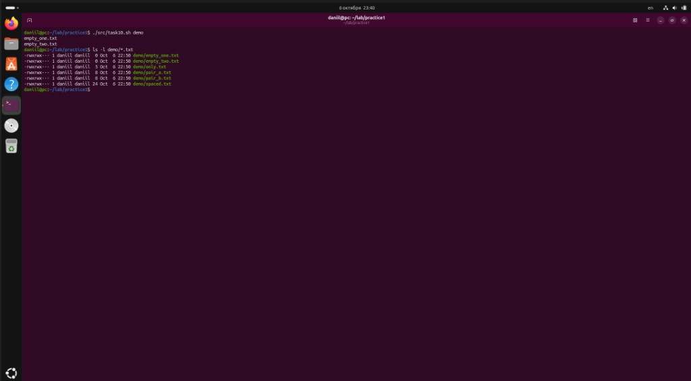

Пустые только `empty_one.txt` и `empty_two.txt`.

---

## Сравнение командной строки Windows и Linux

| Возможность | Linux (bash) | Windows (cmd) | Windows (PowerShell) |
|---|---|---|---|
| Список файлов | `ls` | `dir` | `Get-ChildItem` |
| Поиск в тексте | `grep` | `findstr` | `Select-String` |
| Данные в конвейере | строки текста | строки текста | объекты .NET |
| Права файла | `chmod` | `icacls` | `Set-Acl` |
| Разделитель пути | `/` | `\` | `\` |
| Регистр в именах | различается | не различается | не различается |
| Признак исполняемого файла | бит выполнения | расширение `.exe`, `.bat` | расширение и политика выполнения |

В bash короткие программы соединяются текстом. В задаче 7 это цепочка
`find`, `sha256sum`, `sort` и `awk`. В cmd такого набора нет, и ту же цепочку
собрать трудно. PowerShell передаёт объекты, поэтому те же действия выглядят
иначе и не копируются из bash дословно.

---

## Вывод

На практике разобраны `grep`, `sort`, `awk`, `find`, `tar`, `sha256sum` и сценарии
bash: проверка аргументов, коды выхода и передача имён файлов через NUL.
Рамка `banner` проверена в ShellCheck, предупреждений нет.
